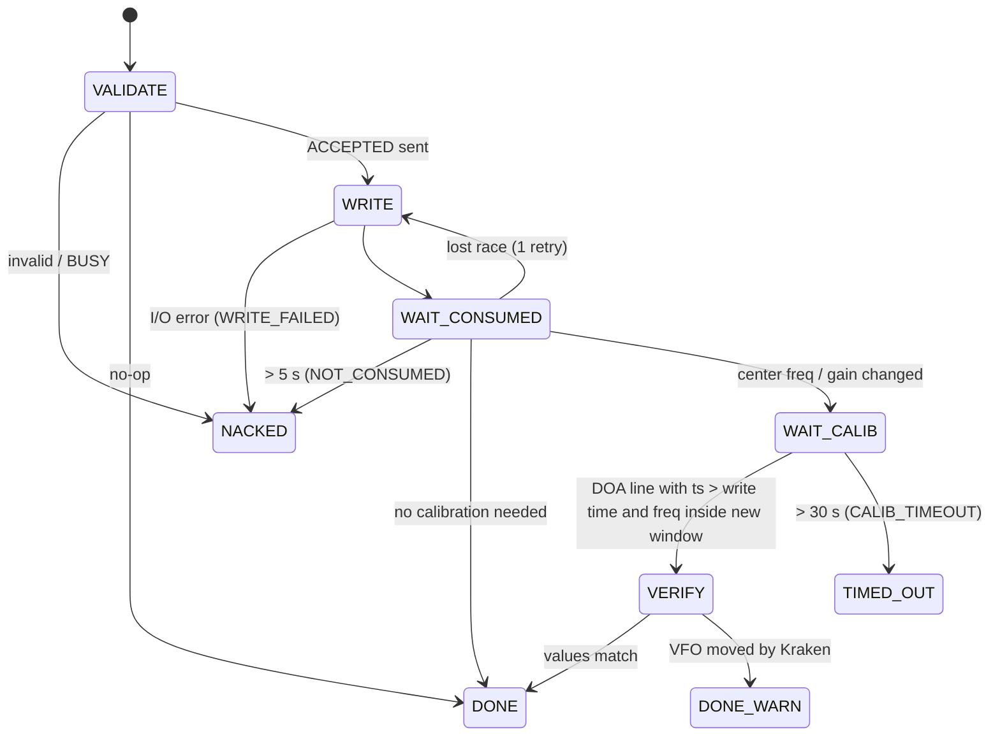
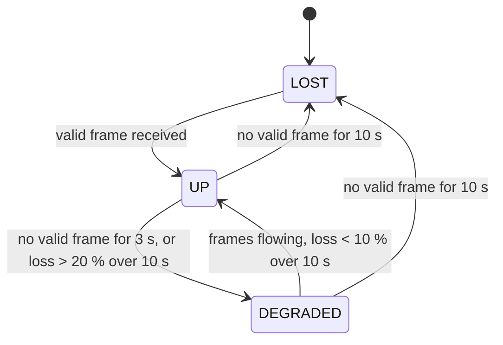

# KrakenLink — drone-to-ground link for KrakenSDR DOA

**Status: PHASE 1 DRAFT — awaiting approval. No implementation until approved.**
Spec version 0.1 · 2026-11-05

---

# Goal

Get KrakenSDR DOA results from a Raspberry Pi on a drone to a custom ground
station, and let the ground change a small, validated set of Kraken settings.
The data travels over the existing flight-controller (FC) MAVLink telemetry
link (Transport A) or, as a fallback, an ESP32 ESP-NOW pair (Transport B).
Both transports carry identical application frames.

Everything new lives in `krakenlink/` (repo root). The vendored
`krakensdr_doa/` is **not modified**.

```
krakenlink/
  proto/            # shared Python package: frame codec, CRC, messages, command validation
  bridge/           # Pi daemon: kraken_io, fc_mavlink, transports/{mavlink,espnow_uart,loopback}, logger
    systemd/krakenlink-bridge.service
    config.example.toml
  ground/           # Dash/Plotly ground app + transports/{mavlink,espnow_serial,loopback}
  sim/              # Kraken simulator (fake DOA_value.html + settings.json + calibration gaps)
  firmware/esp32_link/   # PlatformIO/Arduino; one firmware, role chosen by build flag (AIR/GROUND)
  tests/            # pytest: codec, CRC, validation, bridge state machines vs simulator
```

---

## 1. Findings from the vendored Kraken code (these override the brief where they differ)

| # | Finding | Source | Effect on design |
|---|---------|--------|------------------|
| F1 | **All** `vfo_freq_0..15` are stored in **Hz**; `center_freq` is MHz. The brief's "vfo_freq_1..15 in MHz" does not match this version. | `_nodejs/settings.json`, `kraken_web_interface.py:345`, `utils.py:355` | Bridge writes every VFO in Hz. Unit handling stays in one table (`proto/units.py`), so it's easy to change if real hardware differs. |
| F2 | Settings are applied by `settings_change_watcher`, a 0.5 s timer in the **Python web-UI process**, started from its constructor. It reloads `settings.json` when its mtime changes, and saves back (clearing `ext_upd_flag`) only when `ext_upd_flag` is true. No browser tab is involved. | `utils.py:245-416`, `kraken_web_interface.py:271` | Headless should work while the UI process is running. Still to be confirmed on hardware (Q1). |
| F3 | Kraken **silently moves** any VFO outside the new window to the center frequency after a center/gain change. | `utils.py:383-390` | The bridge rejects out-of-window VFOs before writing anything, and on a retune it also checks and reports VFOs that Kraken will move. |
| F4 | `:8042 POST /settings` **replaces the whole file** with the request body. A partial JSON object wipes every other key. | `_nodejs/index.js` | Never post partial JSON. The bridge's default is a direct atomic file write (§6.2). |
| F5 | `DOA_value.html` is a local file rewritten in place (`seek(0); write; truncate`), so it isn't atomic and a reader can see a partial file. | `kraken_sdr_signal_processor.py:97,781` | Bridge reads the **file** directly (cheaper than HTTP). It drops lines with the wrong field count and re-reads after 20 ms. |
| F6 | Field 2 = `360 − theta_0`. The per-degree array (fields 18..377) is in the **theta domain** and shifted so its minimum is 0 (dB above floor). | `kraken_sdr_signal_processor.py:758-768` | Compass bin = `(360 − i) mod 360`, **not** `90 − i` as the brief says. To be checked against hardware (Q2). Bearing 360 is normalized to 0. |
| F7 | Line format: `ts, bearing, conf, rssi, freq, array, latency, station, lat, lon, heading, heading, GPS, R, R, R, R, p0..p359` = 377 fields. | same | Parser requires exactly 377 fields. |
| F8 | DOA methods offered by the UI: Bartlett, Capon, MEM, TNA, MUSIC, ROOT-MUSIC. | `variables.py:111-116` | Command enum. |
| F9 | `ant_spacing_meters` is the **radius** for UCA and the element spacing for ULA. | `utils.py:283-309` | One "array geometry" command, with units documented per array type. |
| F10 | The current `settings.json` has `doa_data_format = "Kraken Pro Remote"`. | `_nodejs/settings.json` | At startup the bridge checks for `"Kraken App"` and sets it if needed (logged). |

---

## 2. System architecture

```
                         DRONE                                                    GROUND
┌───────────────────────────────────────────────────────┐        ┌──────────────────────────────────────┐
│ Raspberry Pi                                          │        │ Laptop                               │
│ ┌───────────────────┐  file/HTTP   ┌────────────────┐ │        │ ┌──────────────────────────────────┐ │
│ │ krakensdr_doa     │◄────────────►│ krakenlink     │ │        │ │ krakenlink ground app (Dash)     │ │
│ │  DSP + web-UI proc│ DOA_value    │ bridge daemon  │ │        │ │ compass · trends · link stats    │ │
│ │  (_share/         │ settings.json│ (systemd)      │ │        │ │ settings panel · map overlay     │ │
│ │   settings.json)  │              │ ┌────────────┐ │ │        │ └───────▲──────────────▲───────────┘ │
│ └───────────────────┘              │ │CSV logger  │ │ │        │   Transport A      Transport B       │
│                                    │ └────────────┘ │ │        │         │              │ USB serial  │
│                                    └─┬───────────┬──┘ │        │  ┌──────┴──────┐ ┌─────┴──────┐      │
│                       UART MAVLink2  │           │UART│        │  │mavlink-router│ │ESP32 GROUND│      │
│                       (comp 191)     │           │COBS│        │  │ UDP fan-out  │ └─────▲──────┘      │
│                                ┌─────▼────┐ ┌────▼──┐ │        │  └──▲───────▲───┘       │             │
│                                │ Pixhawk  │ │ESP32  │ │        │     │       │ QGC /    │             │
│                                │ FC       │ │AIR    │ │        │     │       └ Mission  │             │
│                                └─────┬────┘ └───┬───┘ │        │     │         Planner  │             │
│                                 telemetry radio │     │        │  telemetry radio        │             │
└──────────────────────────────────────┼──────────┼─────┘        └─────┼───────────────────┼─────────────┘
                                       └── A: MAVLink TUNNEL ──────────┘                   │
                                                  └──────── B: ESP-NOW 2.4 GHz ────────────┘
```

**Layering (identical on both ends):**

```
 App layer     : DOA / SPECTRUM / STATUS / POSE / PING / PONG / CMD / ACK / SETTINGS
 Frame layer   : KLF frame (magic, version, type, len, seq, payload, CRC16)   ← proto/
 Transport     : A) MAVLink2 TUNNEL(385) payload      B) COBS over UART ↔ ESP-NOW payload
```

A transport driver implements just `send(frame_bytes)` and `recv() -> frame_bytes | None`,
plus `stats()`. The bridge and ground app pick a driver through config. A
`loopback` driver (UDP or in-process) is used for bench tests.

**Position and heading** always come from the FC (MAVLink `GLOBAL_POSITION_INT`,
`ATTITUDE`/`VFR_HUD`) on the Pi's own FC connection. The Kraken lat/lon/heading
fields (9–12) are ignored. The bridge attaches the FC heading at DOA time to each
DOA frame, so the ground can compute an absolute bearing on either transport.

---

## 3. Frame layout (KLF v1)

All multi-byte fields are **little-endian**. Max frame size = **128 B** (MAVLink
TUNNEL payload limit), and the same limit applies on ESP-NOW (250 B) so frames are portable.

| Offset | Size | Field | Notes |
|-------:|-----:|-------|-------|
| 0 | 1 | `magic` | constant `0xA7` |
| 1 | 1 | `ver_flags` | bits 7..4 = protocol version (1); bit 0 = `RETRY` (command resend); bits 3..1 reserved = 0 |
| 2 | 1 | `type` | message type, see §4 |
| 3 | 1 | `len` | payload length N, 0..120 |
| 4 | 2 | `seq` | u16, per-sender, per-direction, wraps at 65535 |
| 6 | N | `payload` | |
| 6+N | 2 | `crc` | CRC-16/CCITT-FALSE (poly 0x1021, init 0xFFFF, no reflect, xorout 0) over bytes 0..5+N |

Overhead 8 B → **max payload 120 B**. Receivers drop frames with the wrong magic,
an unknown major version, `len > 120`, a length mismatch, or a bad CRC, and count
each drop by reason. Unknown `type` with a valid CRC → count and ignore (lets the protocol grow).

Test vector (must be in unit tests): CRC-16/CCITT-FALSE of ASCII `"123456789"` = `0x29B1`.

---

## 4. Messages

### 4.1 Type table

| Type | Name | Dir | Default rate | Payload B | Frame B |
|-----:|------|-----|--------------|----------:|--------:|
| 0x01 | DOA | ↓ | 5 Hz per active VFO | 23 | 31 |
| 0x02 | SPECTRUM | ↓ | 1 Hz (output VFO only) | 83 | 91 |
| 0x03 | STATUS | ↓ | 1 Hz | 28 | 36 |
| 0x04 | POSE | ↓ | 2 Hz | 20 | 28 |
| 0x05 | SETTINGS | ↓ | on request (multi-part) | ≤ 120 | ≤ 128 |
| 0x10 | CMD | ↑ | on demand | 3..19 | 11..27 |
| 0x11 | ACK | ↓ | per CMD stage | 8 | 16 |
| 0x20 | PING | ↑ (ground→air) | 1 Hz | 6 | 14 |
| 0x21 | PONG | ↓ | per PING | 10 | 18 |

↓ = air→ground, ↑ = ground→air.

### 4.2 DOA (0x01), 23 B

| Off | Type | Field | Units / range |
|---:|---|---|---|
| 0 | u8 | `vfo` | 0..15 |
| 1 | u8 | `flags` | b0 FC heading valid, b1 data stale (> 2 s old), b2 calibrating |
| 2 | u64 | `kraken_ts_ms` | Kraken field 1, Unix epoch ms |
| 10 | u16 | `bearing_cdeg` | 0..35999, compass relative to array (Kraken field 2 × 100, 360→0) |
| 12 | u8 | `confidence` | 0..99 (clamped) |
| 13 | i16 | `rssi_ddb` | dB × 10, ≤ 0 (field 4) |
| 15 | u32 | `freq_hz` | VFO frequency in Hz (field 5) |
| 19 | u16 | `latency_ms` | field 7, saturates at 65535 |
| 21 | u16 | `fc_heading_cdeg` | FC heading at DOA receive time, 0..35999 |

Absolute bearing (ground) = `(bearing + array_offset_cfg + fc_heading) mod 360`. `array_offset_cfg`
is a ground-app setting giving the mounting angle between array element 0 and the airframe nose.
Kraken's own `compass_offset`/`array_offset` are left at 0 (Q6).

### 4.3 SPECTRUM (0x02), 83 B

| Off | Type | Field | Notes |
|---:|---|---|---|
| 0 | u8 | `vfo` | |
| 1 | u64 | `kraken_ts_ms` | matches the DOA frame it came from |
| 9 | u16 | `peak_ddb` | max value of the 360 inputs, dB×10 above floor |
| 11 | u8[72] | `bins` | bin k = compass k×5° (k = 0..71), **max** of the 5 compass degrees centered on that angle; quantized `round(255 × v / peak)` (0 if peak = 0) |

Rotation (F6): compass degree `c` = theta index `i` where `c = (360 − i) mod 360`.
Max-pooling keeps narrow peaks visible after downsampling.

### 4.4 STATUS (0x03), 28 B

| Off | Type | Field | Notes |
|---:|---|---|---|
| 0 | u8 | `bridge_state` | enum §7.1 |
| 1 | u8 | `kraken_state` | 0 OK, 1 STALE, 2 CALIBRATING, 3 DOWN, 4 FORMAT_WRONG |
| 2 | u8 | `link_state` | as seen by bridge: 0 UP, 1 DEGRADED, 2 LOST |
| 3 | u32 | `center_freq_hz` | from settings.json |
| 7 | u16 | `gain_x10` | dB × 10 |
| 9 | u8 | `active_vfos` | |
| 10 | u8 | `doa_method` | enum §5 |
| 11 | u8 | `en_doa` | 0/1 |
| 12 | u16 | `kraken_data_age_ms` | saturating |
| 14 | i8 | `cpu_temp_c` | |
| 15 | u8 | `cpu_load_pct` | 1-min load average / cores × 100, clamped |
| 16 | u32 | `uptime_s` | bridge uptime |
| 20 | u16 | `last_cmd_id` | |
| 22 | u8 | `last_cmd_result` | ACK result code |
| 23 | u16 | `tx_dropped` | frames dropped by rate limiter (wrapping counter) |
| 25 | u16 | `rx_bad` | uplink frames dropped (CRC/len/magic) |
| 27 | u8 | `flags` | b0 logger OK, b1 FC link OK, b2 FC GPS fix ≥ 3D, b3 disk < 10 % free |

### 4.5 POSE (0x04), 20 B

| Off | Type | Field | Source (MAVLink) |
|---:|---|---|---|
| 0 | u32 | `fc_time_boot_ms` | GLOBAL_POSITION_INT.time_boot_ms |
| 4 | i32 | `lat_e7` | GLOBAL_POSITION_INT |
| 8 | i32 | `lon_e7` | GLOBAL_POSITION_INT |
| 12 | i16 | `rel_alt_dm` | relative_alt / 100 |
| 14 | u16 | `heading_cdeg` | GLOBAL_POSITION_INT.hdg (fall back to VFR_HUD.heading×100) |
| 16 | u16 | `groundspeed_cms` | VFR_HUD.groundspeed × 100 |
| 18 | u8 | `fix_type` | GPS_RAW_INT.fix_type |
| 19 | u8 | `sats` | GPS_RAW_INT.satellites_visible |

### 4.6 CMD (0x10)

| Off | Type | Field | Notes |
|---:|---|---|---|
| 0 | u16 | `cmd_id` | ground-chosen, unique per **logical** command; retries reuse it and set `RETRY` |
| 2 | u8 | `opcode` | §5 |
| 3 | 0..16 | `params` | opcode-specific, fixed length per opcode |

### 4.7 ACK (0x11), 8 B

| Off | Type | Field | Notes |
|---:|---|---|---|
| 0 | u16 | `cmd_id` | |
| 2 | u8 | `opcode` | |
| 3 | u8 | `result` | 0 ACCEPTED (validated, applying), 1 DONE (applied and verified), 2 NACK, 3 TIMEOUT (written, not confirmed), 4 DONE_WITH_WARNING |
| 4 | u8 | `reason` | §5.3 |
| 5 | u8 | `detail` | e.g. index of VFO moved by Kraken; else 0 |
| 6 | u16 | `elapsed_ds` | time since ACCEPTED, 0.1 s units |

Two-stage ack: every valid CMD gets ACCEPTED or NACK right away (< 200 ms bridge-side),
then a final DONE / DONE_WITH_WARNING / TIMEOUT once it's applied.

### 4.8 PING (0x20) / PONG (0x21)

PING: `u32 ground_time_ms`, `u16 ground_rx_count` (frames received in the last 1 s, so the bridge sees downlink health).
PONG: `u32 ground_time_ms` (echoed), `u32 bridge_uptime_ms`, `u16 bridge_rx_count`.
The ground computes RTT from the echo. The bridge treats any valid PING as the uplink heartbeat.

### 4.9 SETTINGS (0x05) — snapshot reply to `GET_SETTINGS`

Header: `u16 cmd_id, u8 part, u8 parts`. Part 0 holds globals; parts 1–2 hold VFOs 0–7 and 8–15.

Part 0 body: `u32 center_freq_hz, u16 gain_x10, u8 doa_method, u8 array_type (0 UCA,1 ULA,2 Custom), u16 array_dim_mm, u8 en_doa, u8 active_vfos, u8 output_vfo, u8 dsp_decimation, u8 doa_data_format_ok, u16 telem_doa_hz_x10, u16 telem_spec_hz_x10`.
Parts 1–2 body: 8 × `{u32 freq_hz, u32 bw_hz, i8 squelch_db}` = 72 B.

---

## 5. Command set

### 5.1 Opcodes

| Op | Name | Params (bytes) | Units / allowed values | Kraken keys written | Calibration? |
|---:|------|----------------|------------------------|---------------------|:---:|
| 0x01 | SET_CENTER_FREQ | u32 `hz` | 24 000 000 … 1 766 000 000 Hz (R820T2), 1 kHz step | `center_freq` = hz/1e6 (MHz float) | yes |
| 0x02 | SET_GAIN | u16 `gain_x10` | one of R820T gains (dB): 0, 0.9, 1.4, 2.7, 3.7, 7.7, 8.7, 12.5, 14.4, 15.7, 16.6, 19.7, 20.7, 22.9, 25.4, 28.0, 29.7, 32.8, 33.8, 36.4, 37.2, 38.6, 40.2, 42.1, 43.4, 43.9, 44.5, 48.0, 49.6 | `uniform_gain` | yes |
| 0x03 | SET_VFO | u8 `idx`, u8 `mask`, u32 `freq_hz`, u32 `bw_hz`, i8 `squelch_db` | idx 0..15; mask b0 freq, b1 bw, b2 squelch; bw 100…`fs_eff` Hz; squelch −150…0 dB; window rule §5.2 | `vfo_freq_i` (Hz), `vfo_bw_i` (Hz), `vfo_squelch_i` (dB) | no |
| 0x04 | SET_ACTIVE_VFOS | u8 `count`, u8 `output_vfo` | count 1..16, output_vfo 0..count−1, or 255 = ALL | `active_vfos`, `output_vfo` | no |
| 0x05 | SET_DOA_METHOD | u8 `method` | 0 Bartlett, 1 Capon, 2 MEM, 3 TNA, 4 MUSIC, 5 ROOT-MUSIC (ULA only) | `doa_method` | no |
| 0x06 | SET_ARRAY | u8 `type`, u16 `dim_mm` | type 0 UCA (dim = radius), 1 ULA (dim = spacing); 20…2000 mm | `ant_arrangement`, `ant_spacing_meters` | no |
| 0x07 | SET_DOA_ENABLE | u8 `on` | 0/1 | `en_doa` | no |
| 0x08 | GET_SETTINGS | — | — | none (read only) | no |
| 0x09 | SET_TELEM_RATE | u16 `doa_hz_x10`, u16 `spec_hz_x10` | DOA 0.2…10 Hz; spectrum 0 (off)…2 Hz; bridge-local, capped by the byte budget | none | no |

Fixed parameter lengths are enforced (wrong length → NACK `BAD_LEN`). Floats never
travel over the air; every value is an integer in the units shown.

### 5.2 Validation rules (in `proto/validate.py`, pure functions, unit-tested)

- `fs_eff` = `daq_fs / dsp_decimation`, where `daq_fs` = 2.4 MHz (config; the Kraken DAQ default).
- VFO window: `|freq_hz − center_hz| + bw_hz/2 ≤ fs_eff/2` (uses the **post-command** center).
- On SET_CENTER_FREQ: list the active VFOs (`idx < active_vfos`) that would fall outside the new window. Default policy `reject` → NACK `VFO_OUT_OF_WINDOW` with `detail` = first offending index. Config `retune_vfo_policy = "allow"` → apply, then DONE_WITH_WARNING `VFO_MOVED` (Kraken snaps those VFOs to center, F3).
- ROOT-MUSIC with `ant_arrangement != ULA` → NACK `INCOMPATIBLE`.
- The command is turned into a **key whitelist** of typed values. The bridge never writes keys outside the whitelist and never parses JSON received over the air.
- No-op detection: if every target value already equals the current value → DONE immediately (no write, no calibration).

### 5.3 NACK / result reason codes

| Code | Name | Meaning |
|---:|------|---------|
| 0 | OK | |
| 1 | BAD_OPCODE | unknown opcode |
| 2 | BAD_LEN | params length wrong for opcode |
| 3 | OUT_OF_RANGE | value outside allowed range/set |
| 4 | VFO_OUT_OF_WINDOW | VFO outside the 2.4 MHz window |
| 5 | INCOMPATIBLE | e.g. ROOT-MUSIC + UCA |
| 6 | BUSY | another command is applying (one at a time) |
| 7 | KRAKEN_DOWN | settings file missing or unparseable, or UI process not consuming |
| 8 | WRITE_FAILED | I/O error |
| 9 | NOT_CONSUMED | Kraken didn't pick up the change within 5 s |
| 10 | CALIB_TIMEOUT | no fresh, matching DOA data within 30 s |
| 11 | VFO_MOVED | warning: Kraken moved VFO(s) to center (`detail` = first index) |

### 5.4 Idempotent retry

- Ground: resend the same `cmd_id` (RETRY bit set) every 1.0 s until it gets any ACK, max 5 tries; then mark "no response". After ACCEPTED, wait for the final ACK up to 40 s and resend every 3 s (the bridge replays its cached result).
- Bridge: LRU cache of the last 64 `cmd_id → latest ACK`. A duplicate `cmd_id` **never re-applies**; it re-sends the cached ACK (or ACCEPTED if still running).
- `cmd_id` starts at a random u16 on each ground-app start, which avoids collisions with a stale bridge cache. The cache is in memory, so a bridge restart clears it.

---

## 6. Kraken I/O

### 6.1 Reading DOA

- Primary: read `<kraken_share>/DOA_value.html` when its mtime changes (poll every 50 ms; `os.stat` is cheap). Fallback (config): HTTP GET `:8081/DOA_value.html`.
- Parse each line and require exactly 377 comma-separated fields (F7). On a short or partial read, retry once after 20 ms; then skip that cycle and count it.
- Stale: data age > 2 s → `kraken_state = STALE`; > 10 s → `DOWN`.

### 6.2 Writing settings (default: atomic direct file write)

1. Read `settings.json` and parse it. On failure → NACK `KRAKEN_DOWN`.
2. Apply whitelisted keys with correct units (F1); set `ext_upd_flag = true`.
3. Write to `settings.json.klnk.tmp` in the same directory, `fsync`, then `os.replace` (atomic). Preserve all other keys and their order.
4. **Consumed check:** within 5 s, re-read and expect `ext_upd_flag == false` with our values present (Kraken's `save_configuration` re-saves after loading, F2). Not seen → NACK `NOT_CONSUMED`.

Why not `:8042`: it depends on the Node process and replaces the whole file (F4). It stays available as a config option (`settings_writer = "node_api"`, which does a read-modify-write of the full JSON).

Race: if Kraken saves at the same moment, our write can be lost. The consumed check catches that, and the bridge retries the write once.

### 6.3 Startup checks

- Ensure `doa_data_format == "Kraken App"` (set it via §6.2 if not, and log it).
- Settings path comes from config (default `~/krakensdr_doa/krakensdr_doa/_share/settings.json`, per the brief; Q3).

---

## 7. State machines

### 7.1 Bridge (main)

```mermaid
stateDiagram-v2
    [*] --> INIT
    INIT --> WAIT_KRAKEN: config ok, transports opened (failures logged; retried every 5 s)
    WAIT_KRAKEN --> RUNNING: fresh DOA data and settings readable
    RUNNING --> KRAKEN_STALE: data age > 2 s
    KRAKEN_STALE --> RUNNING: fresh data
    KRAKEN_STALE --> WAIT_KRAKEN: age > 10 s (STATUS kraken_state=DOWN)
    RUNNING --> APPLYING: valid CMD (see 7.2)
    KRAKEN_STALE --> APPLYING: valid CMD that needs no fresh data
    APPLYING --> RUNNING: final ACK sent
```



STATUS and logging keep running in every state. Telemetry frames are sent only when there is fresh data.

### 7.2 Command / retune



During WAIT_CALIB, STATUS shows `kraken_state = CALIBRATING` and DOA frames that still
arrive carry the `calibrating` flag. There is **no automatic rollback** on timeout (the
change most likely applied; rolling back would start another calibration). The ground
operator decides what to do. All timeouts are configurable.

### 7.3 Link (both ends, independent)



- Bridge "valid frame" = ground PING or CMD. Behavior when LOST: Kraken keeps running untouched, CSV logging continues, downlink keeps sending at configured rates (the downlink may still work while the uplink is dead), and an in-flight command finishes and its result is cached for retries. No crash; reconnection needs no action.
- The ground uses any valid downlink frame. It shows **link age** (s since last valid frame), the **time and content of the last good DOA**, a state color, loss %, rate, and RTT.

---

## 8. Bandwidth budget

### 8.1 Transport A — MAVLink2 TUNNEL (msg 385)

On-air size per frame = MAVLink2 header 10 + checksum 2 + TUNNEL fixed fields 5
(target_system, target_component, payload_type u16, payload_length) + KLF frame
(the TUNNEL payload array is sent up to the last non-zero byte). No signing (+13 if enabled).

| Message | KLF B | On-air B | Rate | B/s |
|---|---:|---:|---:|---:|
| DOA (1 VFO) | 31 | 48 | 5 Hz | 240 |
| SPECTRUM | 91 | 108 | 1 Hz | 108 |
| STATUS | 36 | 53 | 1 Hz | 53 |
| POSE | 28 | 45 | 2 Hz | 90 |
| PONG | 18 | 35 | 1 Hz | 35 |
| HEARTBEAT (comp 191, needed for routing) | — | 21 | 1 Hz | 21 |
| **Downlink total** | | | | **547 B/s ≈ 4.4 kbps** ✅ < 5 kbps |
| Uplink: PING 31 B @1 Hz + HEARTBEAT 21 B (ground app as GCS comp) | | | | ~52 B/s ≈ 0.4 kbps |

- Each extra VFO at 5 Hz adds 240 B/s (1.9 kbps).
- **Rate limiter:** token bucket, default 625 B/s (5 kbps), configurable, hard-capped at **1250 B/s (10 kbps)** in code (config values above that are clamped and logged).
- Priority when tokens run short: ACK > STATUS > PONG > DOA (round-robin across VFOs) > POSE > SPECTRUM. Lower priorities are dropped (not queued); each send uses the newest sample.
- With defaults, the budget fits 1 VFO with spectrum, or 2 VFOs at 5 Hz without spectrum. 3–4 VFOs at 5 Hz needs about 7.5–9.6 kbps (near the cap), which is a switch trigger (§9).
- **Back-pressure:** if the telemetry radio reports `RADIO_STATUS` (SiK), throttle to 50 % when `txbuf < 50` and send ACK/STATUS only when `txbuf < 25`.
- Context: a SiK radio at 64 kbps air speed with ECC gives roughly 2–3 kB/s usable each way, and ArduPilot's normal telemetry uses about 1–2 kB/s. 0.55 kB/s is a meaningful share, which is why the field test (§10.4) measures the impact on flight telemetry.

### 8.2 Transport B — ESP-NOW

- UART Pi↔ESP32: 460 800 baud 8N1, frames COBS-encoded with a `0x00` delimiter (+≤ 2 B per frame). Capacity about 46 kB/s, far above need.
- ESP-NOW: one KLF frame per ESP-NOW packet (≤ 128 B of the 250 B limit), unicast to the paired MAC (802.11 MAC-level ACK + retries). On-air overhead is about 50 B MAC/vendor header per packet.
- Default load (same message mix, 11 frames/s): 11 × (KLF + ~50) ≈ 1.1 kB/s on air. A 1 Mbps PHY can handle roughly 30–60 kB/s of usable throughput at this packet size, so 4 VFOs at 10 Hz + spectrum at 2 Hz (≈ 4 kB/s) leaves a large margin. Software cap in the bridge: 6250 B/s (50 kbps), configurable.
- Range: to get past the Pi's onboard WiFi at 60–80 m, use an ESP32 module with an **external antenna** (u.FL), and optionally ESP32 **Long Range (LR) mode** on both ends (config flag; trades rate for sensitivity).
- The ESP32 firmware forwards opaque frames. It **does not** parse app messages, but checks the KLF CRC on both sides and counts errors. On boot, a link-status frame (`type 0x7F`, local only, never forwarded) reports the ESP32's RSSI, retries, and drops to the host about 1 Hz.

---

## 9. When to switch from MAVLink (A) to ESP-NOW (B)

Measured during a field test at the operating range (60–80 m and 120 m margin), in 60 s windows.
**Switch to B if ANY of these happens:**

| # | Trigger | Threshold |
|---|---------|-----------|
| S1 | App frame loss (from `seq` gaps) | > 5 % in 3 consecutive 60 s windows |
| S2 | FC HEARTBEAT gaps at the GCS | any gap > 2 s more than once per 5 min **with the bridge on**, and not without it |
| S3 | Flight telemetry impact | GCS message rate for ATTITUDE/GLOBAL_POSITION_INT drops > 20 % with the bridge on vs off |
| S4 | Command latency | ACCEPTED RTT p95 > 3 s |
| S5 | Radio buffer | SiK `txbuf` < 30 % for > 10 % of the time |
| S6 | Bandwidth need | the required mission profile needs > 10 kbps (e.g. ≥ 3 VFOs at 5 Hz + spectrum) |

**Stay on A** if none fire over ≥ 15 min of flight-representative operation.
The ground app computes S1, S4, and S5 live and shows a "switch advised" badge.
S2/S3 come from the comparison test in §10.4.

---

## 10. Test plan

### 10.1 Unit (pytest, no hardware) — Phase 2 verify command

- CRC: the `0x29B1` vector; a 1-bit flip in any byte is detected.
- Codec: encode→decode round trip for every message type, with boundary values (bearing 0/35999, rssi −32768/0, freq max, u16 seq wrap); reject wrong magic, version, `len > 120`, length mismatch, and truncated frames; every encoded frame ≤ 128 B.
- CSV parser: valid 377-field line; partial line; 360→0 normalization; spectrum rotation (`c = (360 − i) mod 360`) and 5° max-pooling with a synthetic peak at known theta.
- Validation: every opcode's min/max/±1 outside; the full gain set and a non-member (e.g. 15.0 dB); VFO window edges (exactly at the edge = pass, 1 Hz over = fail) with decimation 1 and 2; retune VFO policy; ROOT-MUSIC + UCA; units (center written in MHz, VFO in Hz).
- Idempotency: the same `cmd_id` twice → one write, two identical ACKs.
- COBS: round trip, including frames that contain `0x00`.

### 10.2 Integration (simulator, bench)

The simulator (`krakenlink/sim`) writes a `DOA_value.html` file (and serves it on
`:8081`), a `settings.json` with an emulated `settings_change_watcher` (0.5 s
poll, clears `ext_upd_flag`), and a configurable **calibration gap** (default 8 s
of no data) after center/gain changes. Bad-value mode: if it gets an invalid
value, it stops producing data, mimicking a crash. Tests:
- bridge ⇄ loopback transport ⇄ ground: all message types arrive; rates stay within ±10 %; byte rate ≤ the bucket.
- SET_CENTER_FREQ round trip: ACCEPTED < 200 ms; DONE after the gap; STATUS shows CALIBRATING during the gap.
- Simulator never receives an invalid value across a fuzz run (10 000 random CMD frames): **zero** simulator "crashes".
- Link loss: drop 100 % of frames for 30 s, then restore; the bridge keeps running, the CSV has no gap, and the ground shows LOST → UP with the correct link age.
- Simulator stopped/restarted: the bridge goes STALE → DOWN → RUNNING without restarting.
- Bridge CPU on a Pi 4 with the simulator: **< 5 % of one core** average, RSS < 60 MB.

### 10.3 Transport bench

- A: ArduPilot SITL + `mavlink-router` (or a real FC on the bench + USB): TUNNEL routed both ways with bridge comp 191; QGC/Mission Planner still connected and unaffected.
- B: two ESP32s on the bench: 100 000 frames, 0 undetected corruptions, loss < 0.1 % at 1 m; UART unplug/replug recovers in < 2 s.

### 10.4 Field

At 20 / 40 / 60 / 80 / 120 m, line of sight, 10 min each: loss %, RTT p50/p95, ACK times,
and for A, GCS telemetry rates with the bridge **off then on** (feeds S2/S3). Pass at 80 m:
loss < 5 %, RTT p95 < 2 s, all §9 triggers clear (or switch to B).

---

## 11. Error handling summary

| Condition | Bridge behavior | Ground shows |
|---|---|---|
| Kraken file missing/unparseable | STATUS kraken_state DOWN; retry every 1 s; commands → NACK KRAKEN_DOWN | red Kraken badge |
| Partial DOA read | retry once, then skip; count | — |
| FC MAVLink port lost | reopen every 2 s; POSE stops; DOA `fc_heading_valid = 0`; STATUS b1 = 0 | "no FC heading" |
| Transport A/B port lost | reopen every 2 s; keep logging | link LOST |
| Bad frame (CRC/len/magic) | drop and count (`rx_bad`) | loss % |
| Disk full / log write error | stop logging, STATUS b0 = 0, keep the link up | warning |
| Unhandled exception in a loop | caught at loop level and logged with a traceback; the loop restarts after 1 s; systemd `Restart=always` as the last resort | uptime reset visible |

**Local CSV log** (`/var/log/krakenlink/doa_YYYYMMDD.csv`, line-buffered, flushed every 1 s, rotated daily, kept ≤ 500 MB total):
`utc_iso, kraken_ts_ms, vfo, bearing_deg, confidence, rssi_db, freq_hz, latency_ms, fc_heading_deg, lat, lon, rel_alt_m, link_state`.
Every DOA sample read is logged, not just the ones sent.

---

## 12. Ground app (Phase 2 scope)

Python **Dash/Plotly** (the same stack as Kraken's own UI; runs in a browser on the laptop).
- Live compass polar plot: latest bearing (relative and absolute), spectrum overlay, fading history.
- Trends (last 5 min): RSSI, confidence, per VFO.
- Link panel: state, link age, last good packet time, loss %, frames/s, B/s, RTT, rx_bad, "switch advised".
- Settings panel: one control per opcode, client-side range checks (mirroring `proto/validate.py`), per-command status (pending/accepted/done/nack + reason), "Request snapshot" button.
- Map: drone position/heading from POSE, plus bearing lines from the drone (Plotly scattermapbox with open tiles; works offline with no tiles).
- Transport selected by config: `mavlink` (UDP from `mavlink-router`), `espnow` (serial port), `loopback`.

## 13. Bridge runtime

- Python ≥ 3.9, deps: `pymavlink`, `pyserial`, `tomli` (on 3.9/3.10). No numpy needed on the bridge (360 → 72 pooling in pure Python is trivial).
- Single process, `selectors`/threads: Kraken reader (50 ms poll), FC reader, transport rx, scheduler (rate limiter), command worker (one at a time). Runs at `Nice=10` so Kraken's DSP keeps priority.
- systemd unit: `After=` the Kraken service(s), `Restart=always`, `RestartSec=2`, runs as an unprivileged user in `dialout`.
- MAVLink: own connection to the FC (TELEM2 UART), `source_system` = vehicle sysid, `source_component = 191` (MAV_COMP_ID_ONBOARD_COMPUTER), sends HEARTBEAT `MAV_TYPE_ONBOARD_CONTROLLER` at 1 Hz. Downlink TUNNEL `target_system = 255` (GCS), `target_component = 0`; `payload_type = 0xA700` (private value; Q8). Requests ATTITUDE/GLOBAL_POSITION_INT/VFR_HUD/GPS_RAW_INT at 2–5 Hz on that port via `SET_MESSAGE_INTERVAL`.

---

## 14. Assumptions

- A1. ArduPilot firmware on the FC (routing as described; PX4 needs `MAV_x_FORWARD=1` and is untested).
- A2. The Pi connects to FC TELEM2 at 921 600 baud, `SERIAL2_PROTOCOL=2`.
- A3. On the ground, `mavlink-router` (or MAVProxy `--out`) splits the telemetry radio stream to the GCS and the ground app over UDP.
- A4. `daq_fs` = 2.4 MHz, R820T2 tuners (standard KrakenSDR).
- A5. Pi 4 (or 5) running the standard Kraken image, which has both the Python UI process and the Node process (8042).
- A6. Ground laptop runs Linux or Windows with Python 3.10+.
- A7. One drone, one ground station. No encryption/auth beyond CRC in v1 (see Q9).

## 15. Open questions

- **Q1.** Headless apply: the code says the watcher runs in the UI process with no browser needed (F2). Can you confirm that the "only with UI tab open" report was on an older image? It will be verified on the bench either way.
- **Q2.** Spectrum orientation: the code implies compass = `360 − theta`, while your notes say "east = 0" (`90 − theta`). I'll follow the code and add a bench check with a known transmitter direction. OK?
- **Q3.** Real path of `settings.json` / `DOA_value.html` on your Pi image (the vendored tree has no `_share/`)?
- **Q4.** Telemetry radio model and band (SiK 433? 915? ELRS/other?) and its air data rate. This sets the real budget for Transport A and its legality (below).
- **Q5.** ArduPilot or PX4? Which FC serial port is free for the Pi?
- **Q6.** How the array is mounted relative to the nose (fixed offset), and whether the antenna array can rotate.
- **Q7.** How many VFOs at once in a typical mission? (≥ 3 at 5 Hz pushes Transport A past its budget.)
- **Q8.** Is a private TUNNEL `payload_type` (0xA700) acceptable, or do you want a registered/other value?
- **Q9.** Do you need command authentication (e.g. HMAC-truncated tag) so a third party on the same link can't retune the Kraken? This would add 4–8 B to CMD.
- **Q10.** Is "Kraken App" output for all VFOs (`output_vfo = ALL`) acceptable? It affects the DOA rate.

## 16. Radio legality (India) — flagged, verify before flight

- **Transport B (ESP-NOW, 2.400–2.4835 GHz):** license-exempt (delicensed) band in India for low-power WiFi-class devices. ESP32 LR mode stays in the same band. Expected **OK** at stock ESP32 power. Keep within the EIRP limit when adding a high-gain antenna.
- **Transport A depends on your telemetry radio:**
  - **915 MHz SiK (US band): NOT legal in India.** Don't use it.
  - **865–867 MHz:** license-exempt band in India (low power). A radio must be configured for it.
  - **433.05–434.79 MHz:** license-exempt in India at very low power (on the order of 10 mW). Common 100 mW 433 SiK radios may exceed this; check the settings.
  - **2.4 GHz** telemetry: same as Transport B.
- The KrakenSDR is **receive-only** (no transmit license needed). Direction-finding or monitoring licensed services may still be restricted; that's the operator's responsibility.
- Drone operations: Drone Rules 2021 / DigitalSky (zone permission, UIN, remote pilot certificate) apply regardless of the link.
- Exact power limits and notification numbers must be confirmed against current WPC notifications. This spec doesn't give legal advice.

---

# Acceptance criteria (Phase 2 — checked by reviewer)

- [ ] `krakenlink/proto`: frame codec + CRC-16/CCITT-FALSE + all §4 messages; `"123456789"` → `0x29B1`; all frames ≤ 128 B.
- [ ] `krakenlink/proto/validate.py`: every §5 rule; never emits keys outside the whitelist; center written in MHz, VFOs in Hz.
- [ ] CSV parser handles F5/F6/F7 (partial reads, 360→0, spectrum rotation + 5° max-pool).
- [ ] Bridge: §6 atomic write + consumed check; §7 state machines; idempotent cmd cache; token-bucket limiter with the 1250 B/s hard cap (MAVLink) and priority order; CSV logger; survives link loss and Kraken restarts.
- [ ] Transports: MAVLink TUNNEL (comp 191, HEARTBEAT, payload_type 0xA700), ESP-NOW-UART (COBS), loopback; same app frames on all.
- [ ] systemd unit + `config.example.toml`.
- [ ] Simulator: file + HTTP output, emulated watcher, calibration gap, crash-on-invalid mode.
- [ ] Ground app: compass, trends, link stats with link age / last good packet, settings panel with ACK states, POSE map, transport selectable.
- [ ] ESP32 firmware builds for AIR and GROUND roles; CRC check, counters, COBS UART.
- [ ] Unit + integration tests from §10.1 and the loopback/simulator parts of §10.2 pass, including the 10 000-command fuzz with zero simulator crashes.

# Test/verify command

```bash
cd krakenlink && python -m pytest -q tests && (command -v pio >/dev/null && pio run -d firmware/esp32_link || echo "pio not installed: firmware build SKIPPED")
```
